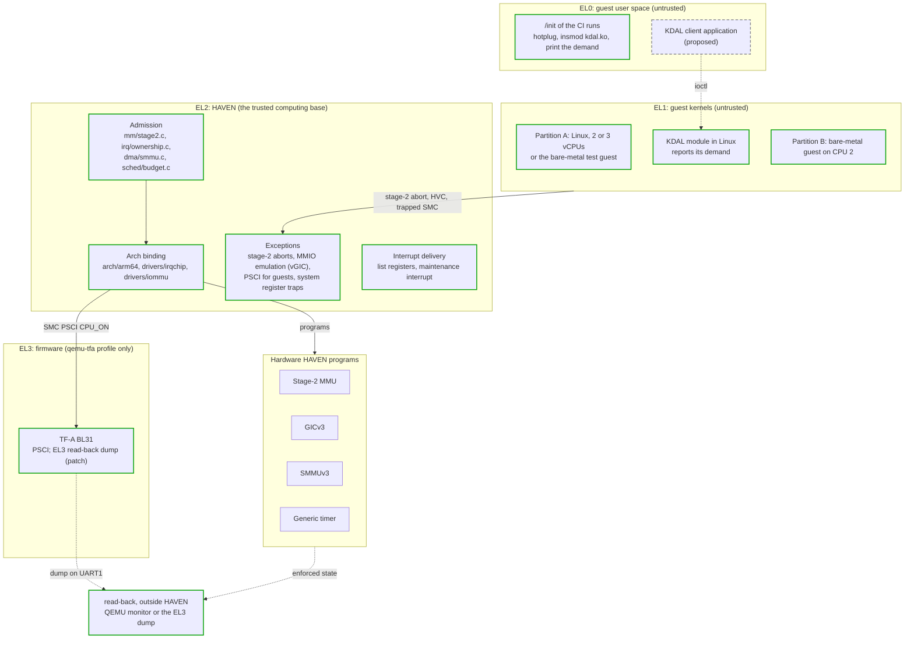

# What runs where, and what is trusted?

Armv8/v9 exception levels in the QEMU setup. Sources: `src/core/`,
`arch/arm64/`, `src/core/partition.c`, `src/platform/qemu-virt/memory.h`,
`tools/readback/README.md`, `tools/el3-readback/README.md`,
`.github/workflows/ci.yml` (jobs "Linux in partition A" and "Partition B
under TF-A").

- Everything at EL1 and EL0 is untrusted, including what KDAL says about
  its own needs. HAVEN at EL2 is the only trusted part; read-back is a host
  tool and never runs inside HAVEN.
- Without TF-A (profiles qemu-direct and qemu-psci) HAVEN is entered at EL2
  directly and there is no EL3 software.
- No KDAL client application runs in HAVEN's partitions yet.
