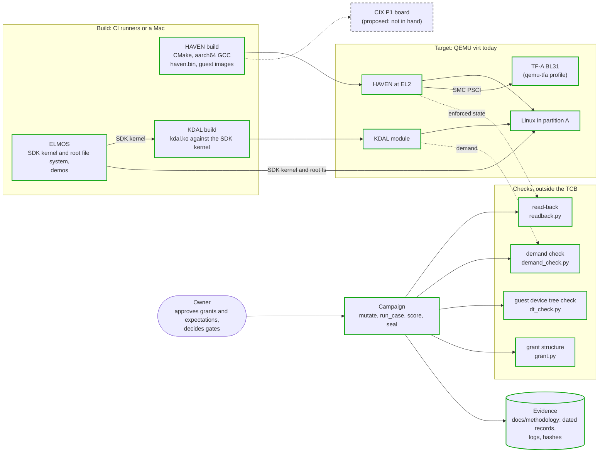

# What are the three repositories, and who depends on whom?

Build time and run time. Sources: `.github/workflows/ci.yml`,
`tools/readback/`, `tools/campaign/`, `docs/methodology/`, ELMOS's
`docs/developer/sdk-ci.md`, the [ecosystem page](https://docs-haven.vercel.app/start/ecosystem/).

- Dependencies point one way: ELMOS and KDAL never need HAVEN to build;
  HAVEN's CI uses a pinned KDAL and ELMOS's SDK kernel.
- The checks read the grant (a JSON file the owner approves) and what the
  target shows; none of them runs inside HAVEN.
- The CIX P1 build compiles in CI (`cix-p1` draft), but no board has run it.
