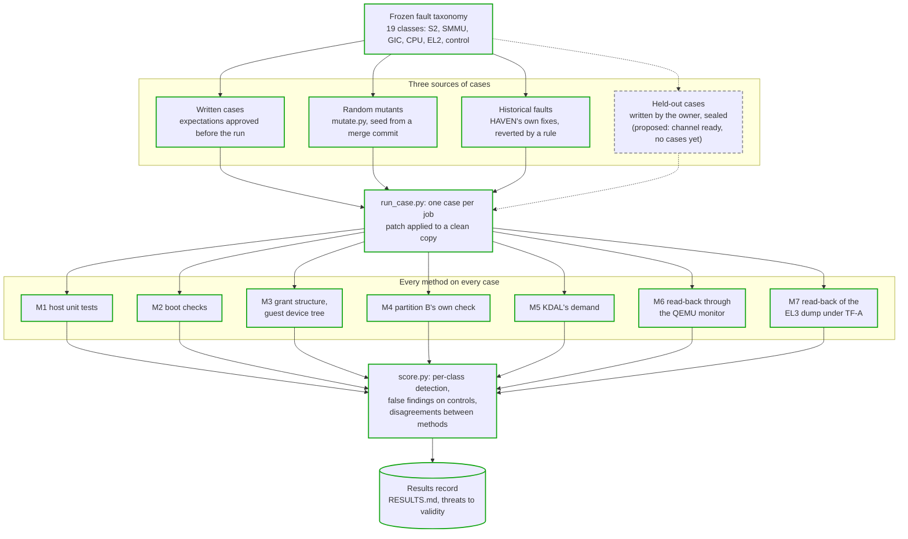

# How is the research question evaluated?

The core evaluation campaign in QEMU. Sources:
`docs/methodology/stage2/20261119-evaluation-campaign/README.md` (design)
and `RESULTS.md` (results of 2026-11-22), `tools/campaign/run_case.py`,
`tools/campaign/taxonomy.json`.

- M1 to M4 and M6 are the baselines and read-back on the same inputs:
  scenario 1 boots the bare test guests; scenario 2 (Linux in partition A)
  replaces M2 and M4 with the Linux runs and adds M5. M7 ran after the main
  run, on the scenario 1 cases.
- **Where the oracle is not independent** (`RESULTS.md`, threats to
  validity): the same author wrote read-back, the written cases and their
  expectations, and classed the random and historical cases. Only held-out
  cases written by the owner would close that gap.
