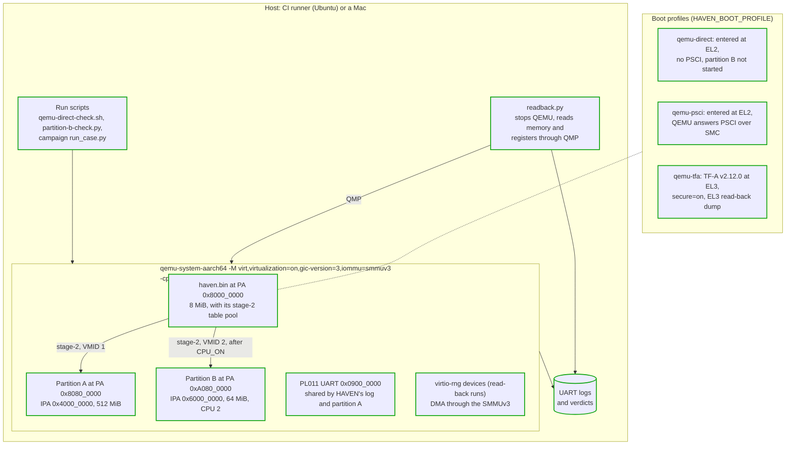

# What exactly runs in QEMU?

The QEMU `virt` evaluator: boot profiles, load addresses and the partition
memory map. Sources: `CMakeLists.txt` (boot profiles),
`src/platform/qemu-virt/memory.h`, `scripts/qemu/qemu-direct-check.sh`,
`scripts/qemu/partition-b-check.py`, `tools/readback/README.md`,
`tools/el3-readback/README.md`.

- Linux in partition A uses the same layout, the qemu-psci profile and a
  device tree; its CI job pins QEMU 8.2.2, whose SMMU has no stage 2, so
  the DMA grant is withheld there.
- QEMU's TCG models function, not timing or caches: QEMU results never
  stand in for a board.
