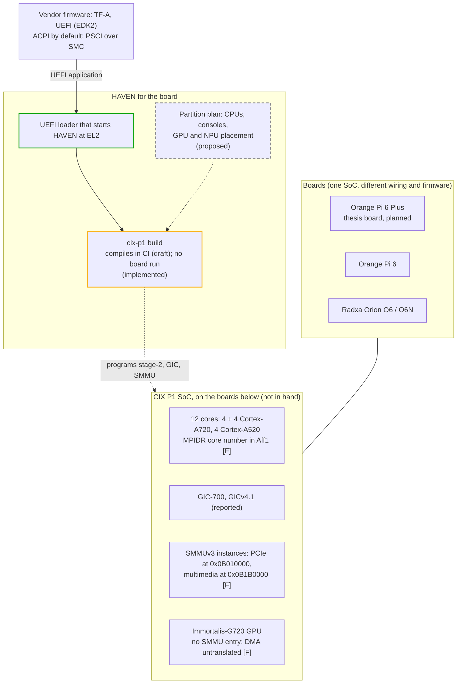

# What is the physical target, and what is unverified?

CIX P1 (Sky1). No board is in hand: everything on the hardware side is
taken from manuals, firmware source and community reports, and nothing is
observed. Sources: `docs/architecture/cix-p1-partition-plan.md` (labels
[F] primary source, [S] community or single source), `src/platform/cix-p1/`,
`boot/efi/`, `.github/workflows/ci.yml` (jobs "Cross-compile (cix-p1
draft)" and "UEFI probe and loader at EL2 in QEMU").

- The UEFI loader is observed only in QEMU (edk2 firmware, CI job "UEFI
  probe and loader at EL2", rows L0 and L1b), not on a board.
- DMA isolation claims for these boards stay experimental: the GPU has no
  SMMU in its path, and the firmware's IORT is reported wrong in places.
- Before any port: board revision, firmware hash, exception level at
  entry, ACPI or device tree, GIC and SMMU register dumps, a recovery path.
