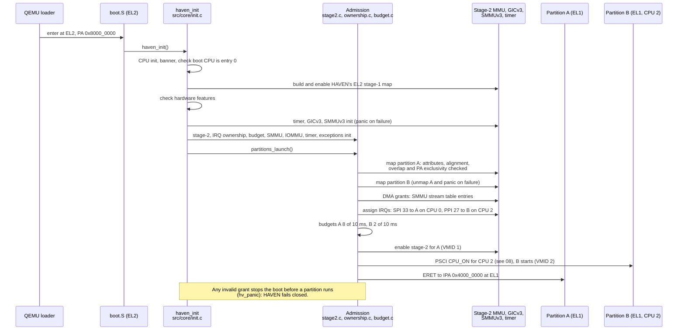

# How does HAVEN reach running, isolated partitions?

Boot on CPU 0 of the QEMU `virt` machine, qemu-psci profile. Everything
shown is observed (every boot check in CI prints these steps). Sources:
`arch/arm64/boot.S`, `src/core/init.c` (`haven_init`),
`src/core/partition.c` (`partitions_launch`), `src/platform/qemu-virt/memory.h`.

- Read-back takes no part in this sequence: it runs from the host after
  boot and reads what these steps wrote (diagram 01).
- With a Linux guest, HAVEN also sets up the emulated GIC for partition A
  and passes the device tree's IPA in x0.
