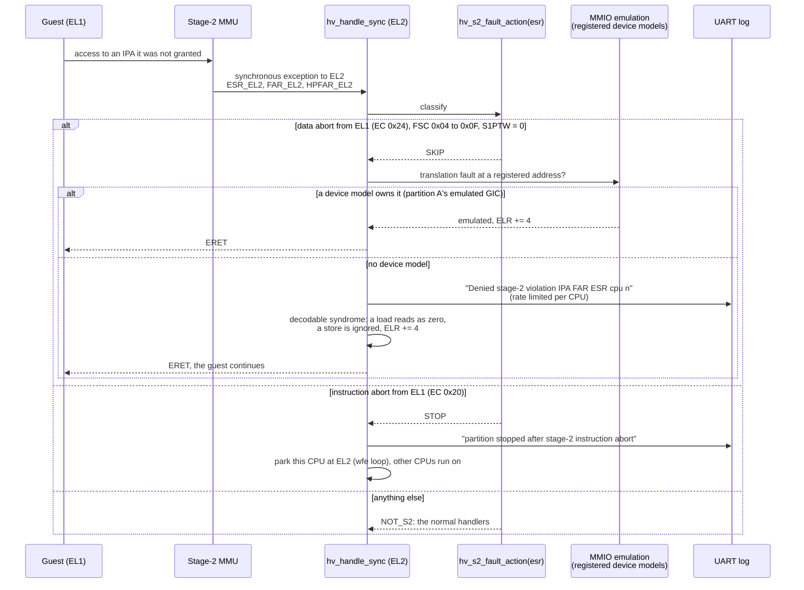

# What happens on a denied guest access?

A guest's load or store, or instruction fetch, outside its stage-2 map.
Sources: `src/core/exc/el2_exceptions.c` (`hv_s2_fault_action`,
`hv_handle_sync`), `src/core/exc/mmio.c`, `include/haven/el2_exceptions.h`.

- Both outcomes are observed: the skipped data abort in every partition B
  check, the stopped partition in case M3 of case set v3
  (`docs/methodology/stage2/20261102-a1-cases-v3/runs/M3/`).
- For a direct stage-2 permission fault the IPA in HPFAR_EL2 may be
  UNKNOWN (Arm ARM), so HAVEN judges permission faults by ESR and FAR.
