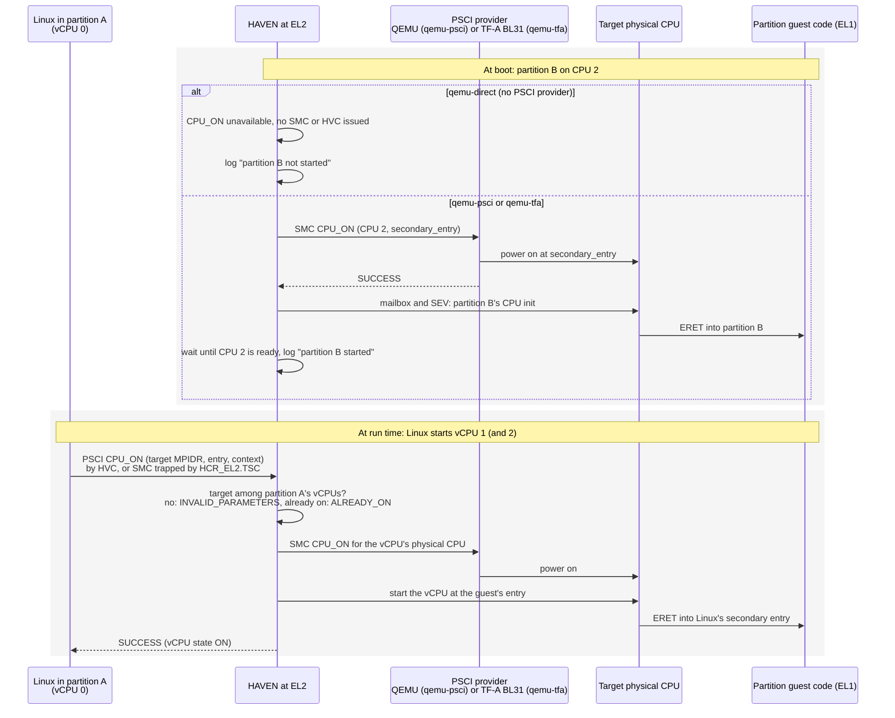

# How are CPUs started, for HAVEN and for a guest?

Two kinds of CPU_ON: HAVEN starting partition B's CPU at boot, and a Linux
guest in partition A starting its own vCPUs, which HAVEN answers itself.
Sources: `CMakeLists.txt` (boot profiles), `src/core/partition.c`
(`partitions_launch`, `hv_partition_start_vcpu`),
`src/core/exc/el2_exceptions.c` (`hv_handle_psci_call`),
`src/core/exc/psci.c`.

- Both paths are observed: partition B starts in every partition B check
  (qemu-psci) and under TF-A; Linux brings up 2 and 3 vCPUs and takes one
  down and up again (CPU hotplug) in the CI job "Linux in partition A".
- A guest's PSCI calls never reach the firmware directly: HAVEN answers
  PSCI_VERSION, PSCI_FEATURES, MIGRATE_INFO_TYPE, AFFINITY_INFO,
  CPU_SUSPEND, CPU_ON, CPU_OFF, SYSTEM_OFF and SYSTEM_RESET itself, and
  returns NOT_SUPPORTED for the rest (`src/core/exc/psci.c`).
