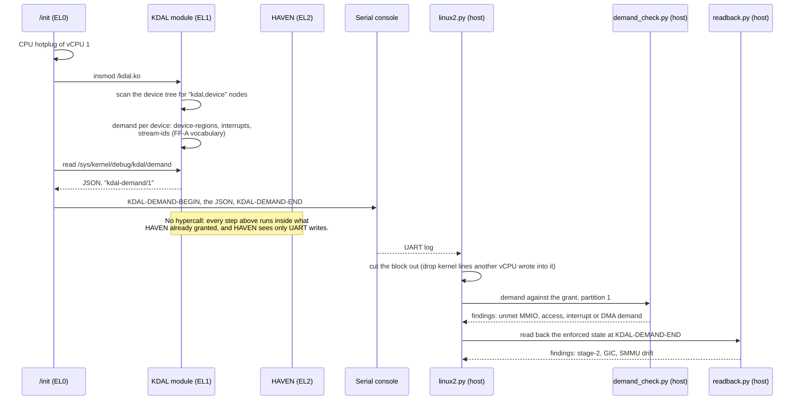

# How does KDAL's demand reach the check without growing the TCB?

Linux with KDAL's module in partition A, as the campaign's scenario 2 and
the CI job "Linux in partition A" run it. KDAL never calls HAVEN: its
demand leaves the guest as text on the serial console and is checked on the
host. Sources: `tools/campaign/linux2.py` (M5, M6),
`tools/readback/demand_check.py`, `docs/methodology/stage2/20261108-multi-vcpu/hotplug-init.c`,
KDAL's `src/core/demand.c` and `src/backends/generic/devicetree.c`.

- Observed on every HAVEN pull request that changes code (2 and 3 vCPUs).
- The unchanged setup has a known, unmet demand that the campaign uses as
  its baseline: KDAL's GPIO device at 0x0903_0000 and its INTID 39 are not
  granted to partition 1. A finding is a demand-check result that differs
  from that baseline.
