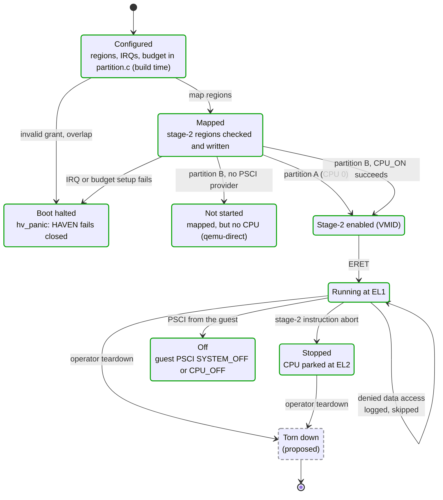

# What states can a partition be in?

Partitions are fixed at build time; there is no run-time creation. Sources:
`src/core/partition.c`, `src/core/exc/el2_exceptions.c`,
`src/core/exc/psci.c`.

- Observed: partition A keeps running after a denied read of partition B's
  memory; a stage-2 instruction abort stops only its own CPU; a Linux guest
  powers off its partition with PSCI SYSTEM_OFF at the end of each CI run.
- Teardown and restart of a partition are not built
  (`hv_stage2_unmap_partition` is used only to undo a failed boot).
