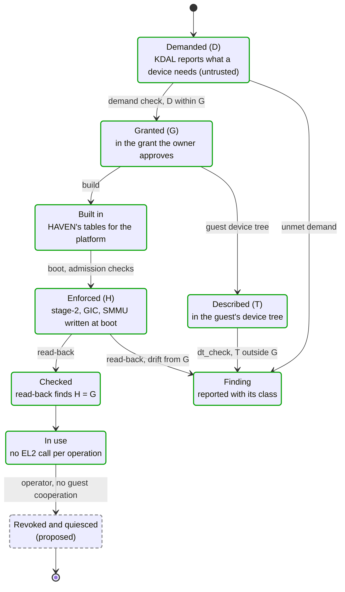

# How does a resource move from demand to checked enforcement?

One resource (a memory or device region, an interrupt, a DMA stream) from
the driver's demand to enforcement that read-back has checked. The checks
on the way are the relations the research question tests. Sources:
`tools/readback/demand_check.py`, `dt_check.py`, `grant.py`,
`readback.py`, `src/core/partition.c`.

- The grant is written by hand and HAVEN's tables in `partition.c` and
  `memory.h` are written to match it; nothing generates one from the other
  (`tools/config-gen/` is reserved). That gap is one reason to read back
  what the hardware enforces.
- Revocation (unmap, retarget interrupts, abort the stream, invalidate
  TLBs, prove nothing is left) is not built.
