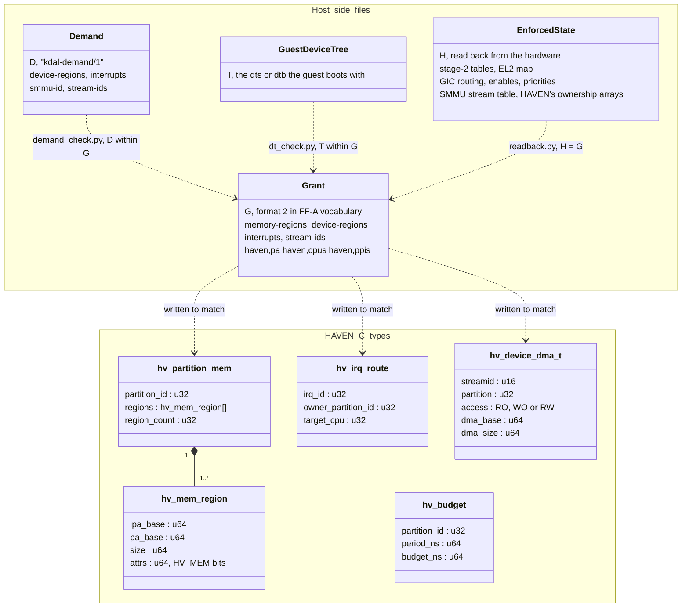

# What data describes a resource, and what is compared?

HAVEN's own types (C, in the trusted code) and the files the host-side
checks compare (JSON). Sources: `include/haven/stage2.h`,
`include/haven/irq_ownership.h`, `include/haven/budget_sched.h`,
`include/haven/smmu.h`, `tools/readback/grant.py`,
`tools/readback/readback.py`, `tools/readback/demand_check.py`,
`tools/readback/dt_check.py`, KDAL's `src/core/demand.c`.

- Every type and file shown is observed: in the code, and used in the CI
  runs and the campaign.
- One vocabulary for D and G: the property names of Arm's FF-A partition
  manifest binding. HAVEN's own additions carry a `haven,` prefix.
- A memory region with `stream-ids` is a DMA window only: it must lie
  inside a CPU-mapped region of the same partition, and read-back checks it
  on the SMMU side (a deliberate deviation from FF-A).
- Budgets are in the C types but not in the grant: read-back checks that
  the EL2 timer that enforces them is on (PPI 26, HAVEN's priority), not
  the budget values.
